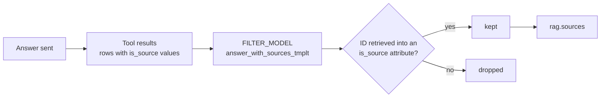

# Sources & Grounding

Vedana can return the list of sources an answer relies on — document IDs, URLs, legal identifiers — and guarantees that every listed source was actually retrieved by a tool during that request.

## Turning it on

1. Mark the citable attributes with `is_source = true` in `Anchor_attributes` / `Link_attributes` (see [Attributes](../data-model/attributes.md#is_source)). Typical candidates: `document.url`, `document.document_id`, `law.eli_id`.
2. Set `EXTRACT_SOURCES=true`.
3. Reload the data model.

If no attribute is marked `is_source`, the step is skipped with a warning, even when `EXTRACT_SOURCES` is on.

## How it works

Source extraction runs **after** the answer has been sent, inside `RagPipeline.send_answer_details`, so it never delays the answer.

1. **Trim the context.** From each tool result, keep only rows that contain an `is_source` value, and cut long strings to 500 characters.
2. **Extract.** `FILTER_MODEL` receives that data plus the answer and returns `{"sources": [{"id": ...}]}`. The system prompt is `answer_with_sources_tmplt`; reasoning is turned off for this call.
3. **Ground.** `ground_sources` keeps an ID only if it exactly matches a value retrieved into an `is_source` attribute on a matching node or edge type. Rows from `vector_text_search` declare their type (`node_type`), and Memgraph nodes carry `labels`; Cypher projections often carry no type, and for those the attribute name alone decides.
4. **Emit.** `rag.sources` is recorded with the grounded list, and the same list is copied into `rag.query_processed.technical_info.sources`.

If extraction fails, a `rag.error` event with `stage: extract_answer_sources` is recorded and the answer is not affected.

## Interaction with data model filtering

When [data model filtering](./vedana-core.md#data-model-filtering) is on, every `is_source` attribute belonging to a selected anchor or link is added to the filtered slice automatically — the agent can always see (and return) the citable fields of the entities it works with.

## Customising extraction

Override `answer_with_sources_tmplt` in the [Prompts](../data-model/prompts.md) table to change what counts as a source — for example, "list only the primary statute, not secondary publications". Grounding still applies: the prompt can narrow the list but can't add IDs that weren't retrieved.

## Settings

| Variable           | Default        | Meaning                                         |
| ------------------ | -------------- | ------------------------------------------------ |
| `EXTRACT_SOURCES`  | `false`        | Run source extraction after the answer.         |
| `FILTER_MODEL`     | `gpt-4.1-mini` | Model used for extraction.                       |
