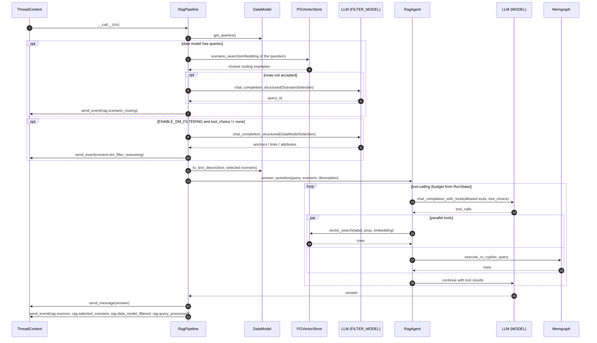

# Vedana Core

`vedana-core` is the RAG layer on top of JIMS. The main modules and their responsibilities:

| Module                          | What's inside                                                                                                  |
| ------------------------------- | --------------------------------------------------------------------------------------------------------------- |
| `vedana_core.app`               | `VedanaApp` and `make_*_app` — component factories.                                                            |
| `vedana_core.rag_pipeline`      | `RagPipeline`, `RagAnswer`, scenario routing (`ScenarioRoute`, `ScenarioSelection`) and data model filtering (`DataModelSelection`). |
| `vedana_core.start_pipeline`    | `StartPipeline` — the `/start` handler.                                                                         |
| `vedana_core.rag_agent`         | `RagAgent` — assembles the per-request toolset and runs the agent loop.                                        |
| `vedana_core.tools`             | Factories for the built-in tools (`vector_text_search`, `cypher`, `select_scenario`, `web_search`), the shared reranker, and `ToolCallRecorder`. |
| `vedana_core.run_state`         | `RunState` — the active scenario, switch count, round budget and pending `tool_choice` for one request.        |
| `vedana_core.mcp_tools`         | Client for remote MCP servers: discovers their tools and wraps each one as a `Tool`.                           |
| `vedana_core.llm`               | `LLM`, `Tool`, prompt templates, the tool-calling loop, source extraction.                                     |
| `vedana_core.source_grounding`  | `ground_sources` — discards extracted sources that don't match a value retrieved into an `is_source` attribute. |
| `vedana_core.strings`           | Default status messages (overridable through ConversationLifecycle).                                            |
| `vedana_core.graph`             | `Graph`, `CypherGraph`, `MemgraphGraph` — graph DB client.                                                     |
| `vedana_core.vts`               | `VectorStore`, `PGVectorStore`, `MemgraphVectorStore` — including `scenario_search` for routing.               |
| `vedana_core.data_model`        | `DataModel`, `Anchor`, `Link`, `Attribute`, `Query`, `Prompt`, `ConversationLifecycleEvent` — the domain schema.|
| `vedana_core.data_provider`     | `GristAPIDataProvider`, `GristSQLDataProvider`, `GristOfflineDataProvider` — read data from Grist.              |
| `vedana_core.eval_reports`      | Builds evaluation reports.                                                                                      |
| `vedana_core.db`                | `get_sessionmaker()` — async SQLAlchemy.                                                                        |
| `vedana_core.settings`          | `VedanaCoreSettings` — pydantic-settings.                                                                       |
| `vedana_core.utils`             | helpers.                                                                                                         |

## `RagPipeline` flow



## RagPipeline

`RagPipeline` implements the JIMS `Pipeline`:

```python
class RagPipeline:
    def __init__(
        self,
        graph: Graph,
        vts: VectorStore,
        data_model: DataModel,
        logger,
        threshold: float = 0.8,
        top_n: int | None = None,           # EMBEDDINGS_TOP_N
        model: str | None = None,           # MODEL
        filter_model: str | None = None,    # FILTER_MODEL
        enable_filtering: bool | None = None,  # ENABLE_DM_FILTERING
        extract_sources: bool | None = None,   # EXTRACT_SOURCES
    ):
        ...

    async def __call__(self, ctx: ThreadContext) -> None: ...
    async def generate_answer(self, query: str, ctx: ThreadContext) -> RagAnswer: ...
    async def send_answer_details(self, query: str, rag: RagAnswer, ctx: ThreadContext) -> dict: ...
```

Execution is split into two phases so the answer can stream to the user before the slower post-processing runs:

1. Get the latest user message (`ctx.get_last_user_message`).
2. **`generate_answer(query, ctx)`** — sends no user-facing messages and returns a `RagAnswer` (`answer`, `agent_trace`, `tool_calls`, `filter_selection`, `selected_scenario`, `graph_filtered`, `run_state`):
   1. If the data model has queries, run `route_scenario`. If routing doesn't accept a scenario, run `select_scenario`, limited to the candidates routing found (see [Scenario routing](../data-model/scenario-routing.md)).
   2. Build the data model description:
      - the scenario has `tool_choice = none` — only that scenario's guidance, no graph elements;
      - `ENABLE_DM_FILTERING` is on — run `filter_data_model` with the chosen scenario locked in;
      - otherwise — the full graph plus the chosen scenario only (or every scenario if none was chosen).
   3. Build a `RagAgent` and call `answer_question`. It creates a `RunState`, activates the scenario, assembles the tools (built-ins, then MCP tools) and runs the [agent loop](./agent-loop.md).
3. Send the answer to the thread (`ctx.send_message`).
4. **`send_answer_details(query, rag, ctx)`** — extracts sources if enabled (see [Sources & grounding](./sources.md)), then emits `rag.sources`, `rag.selected_scenario`, `rag.data_model_filtered` (only when a filtered slice was used) and `rag.query_processed`.
5. On exception — send a generic error to the user and record `rag.error` with traceback.

Status messages (`Processing your question...`, `Analyzing query structure...`, `Searching knowledge base...`, …) are sent along the way; each can be overridden per project through [ConversationLifecycle](../data-model/conversation-lifecycle.md#status-messages).

### Scenario routing

Routing decides which playbook scenario handles the question before the agent starts. It runs whenever the data model has at least one query, regardless of `ENABLE_DM_FILTERING`:

1. Embed the user's last message and fetch the `SCENARIO_ROUTING_TOP_N` closest `routing_examples` from `dm_scenario_examples`.
2. If the best similarity is below `SCENARIO_ROUTING_THRESHOLD`, a `scenario_routing_rerank_query` prompt exists and `RERANKER_BACKEND` is enabled — rerank the candidates.
3. Collapse matches to one row per scenario and decide whether the top one is confident enough (`decide_scenario_route`).
4. If not, ask `FILTER_MODEL` for a `ScenarioSelection` (`reasoning`, `query_id`) over the candidate scenarios.

Each request records a `rag.scenario_routing` event. Full details: [Scenario routing](../data-model/scenario-routing.md).

### Data model filtering

If `enable_filtering=True` (the default), an additional subgraph description extraction step runs before the main agent.

The goal: shrink the main model's context by leaving only the subset of anchors / links / attributes relevant to the current question.

Algorithm:

1. The compact JSON of the data model is taken (`DataModel.to_compact_json`).
2. `LLMProvider.chat_completion_structured` is invoked with `response_format = DataModelSelection` and `model = FILTER_MODEL` (default `gpt-4.1-mini`). `DataModelSelection` is a `BaseModel` with `reasoning`, `anchor_nouns`, `link_sentences`, `anchor_attribute_names`, `link_attribute_names`, `query_id` fields. The prompt includes the recent conversation (`PIPELINE_HISTORY_LENGTH`).
3. `query_id` is set from the scenario routing chose (a 1-based scenario ID); the filter can't override it.
4. Every `is_source` attribute that belongs to a selected anchor or link is added to the selection, so citations survive the narrowing.
5. `DataModel.to_text_descr(...)` renders the selected elements plus the routed scenario into text.

A `context.dm_filter_reasoning` event with the LLM's reasoning is sent into the thread (when filtering succeeded) — it's later included in `ctx.context(...)` (see `ThreadContext.context`).

If the routed scenario has `tool_choice = none`, the filter LLM is skipped: the agent gets the scenario's guidance and no graph description, since it won't call tools.

After the answer has been sent, a `rag.data_model_filtered` event is recorded with full telemetry: `selected_anchors`, `selected_links`, `selected_anchor_attributes`, `selected_link_attributes`, `selected_queries` (at most one entry), `original_counts`, `filtered_counts`, `reasoning`. It is sent only when a filtered slice was actually used.

If filtering raises, the fallback is the full data model plus the routed scenario. The reasoning then starts with `Filtering failed:` and no `context.dm_filter_reasoning` event is sent.

### Building the agent

The `RagAgent` is created with:

- `graph` — the Memgraph client;
- `vts` — the pgvector client;
- `llm` — the `LLM` wrapper over `LLMProvider`;
- `ctx` — the `ThreadContext`;
- `data_model` — the `DataModel` (used for vector indices, `select_scenario` and the MCP cache key).

`RagAgent.answer_question(text_query, threshold, top_n, data_model_description, scenario)` receives the rendered description and the routed scenario.

### Technical trace

After producing the answer, `RagPipeline` collects `technical_info`:

```python
{
    "vts_queries": ["vector_search('label','prop','text')", ...],
    "cypher_queries": ["MATCH ... RETURN ...", ...],
    "num_vts_queries": int,
    "num_cypher_queries": int,
    "model_used": str,
    "model_stats": {model_name: ModelUsage, ...},
    "tool_calls": [{"tool": str, "args": dict, "result": ...}, ...],
    "sources": [{"id": str}, ...],  # when EXTRACT_SOURCES is on
    "scenario": {
        "active": str | None,  # scenario that was active at the end of the loop
        "switches": int,
        "rounds_used": int,
        "budget": int,
    },
}
```

All of it goes into `rag.query_processed`. The backoffice shows it under "Details" beneath the assistant's answer.

## RagAgent and tools

`RagAgent.answer_question(...)`:

1. Creates a `ToolCallRecorder` and a `RunState`; if routing picked a scenario, activates it.
2. Builds the toolset with `vedana_core.tools.build_tools(...)`: `vector_text_search`, `cypher`, `select_scenario`, plus `web_search` when `ENABLE_WEB_SEARCH` is on.
3. Appends remote MCP tools from `build_mcp_tools(...)` (see [MCP tools](../guides/mcp-tools.md)). A remote tool can't shadow a built-in name.
4. Calls `LLM.answer_with_tools(data_descr, messages, tools, ctx, state)`.
5. If the answer is empty, runs `LLM.generate_no_answer(...)`.
6. Returns the answer, the full message trace, the recorded tool calls and the `RunState`.

### The `vector_text_search` tool

`VTSArgs` is a pydantic model with fields:

- `label` — anchor / link name; when at least one embeddable index exists in the data model, the field is constrained by an `Enum` built from `vts_indices`. With no embeddable indexes the base `VTSArgs` (free-string `label`/`property`) is used.
- `property` — field name, similarly Enum-constrained when indexes exist, otherwise a free string.
- `text` — text to search.
- `rerank_top_k` — optional; how many of the best results to keep after reranking.

In code:

```python
async def vts_fn(args: VTSArgs) -> str:
    label = args.label.value if isinstance(args.label, enum.Enum) else args.label
    prop = args.property.value if isinstance(args.property, enum.Enum) else args.property

    prop_type, th, t_n = meta.get(label, {}).get(prop, ("node", threshold, top_n))
    try:
        embed = await llm.create_embedding(args.text)
        vts_res = await vts.vector_search(label, prop_type, prop, embed, threshold=th, top_n=t_n)
    except Exception as e:
        vts_res = e
    tool_result = await apply_reranker(llm, text_query, vts_res, VTS_TOOL_NAME, top_k=args.rerank_top_k)
    recorder.record(VTS_TOOL_NAME, {...}, tool_result)
    return json.dumps(tool_result, ensure_ascii=False)
```

`prop_type` is `"node"` or `"edge"` and selects which pgvector table to compute cosine distance against. `threshold` and `top_n` come from the attribute's `embed_threshold` / `embed_top_n`.

### The `cypher` tool

```python
async def cypher_fn(args: CypherArgs) -> str:
    cypher_res = await execute_cypher_query(args.query, rows_limit=settings.cypher_rows_limit)
    tool_result = await apply_reranker(llm, text_query, cypher_res, CYPHER_TOOL_NAME, top_k=args.rerank_top_k)
    recorder.record(CYPHER_TOOL_NAME, {"query": args.query}, tool_result)
    return json.dumps(tool_result, ensure_ascii=False)
```

`execute_cypher_query` calls `Graph.execute_ro_cypher_query` (read-only). The result is capped at `CYPHER_ROWS_LIMIT` rows (default `1000`) via `itertools.islice`.

### The `select_scenario` tool

Lets the agent switch to a better playbook scenario partway through the loop. Arguments: `id` (1-based scenario ID) and `reason`. Bounded by `AGENT_MAX_SCENARIO_SWITCHES`. See [Agent loop](./agent-loop.md#switching-scenarios).

### Tool results

Every tool returns JSON. Retrieval tools return `{"rows": [...]}`; a failed query returns `{"rows": [], "error": "..."}` so the agent can fix the query in the next round. Rows are normalised in the graph / vector store layer: Memgraph nodes keep their `labels`, relationships their `type`, and embedding fields (ending in `_embedding`) are stripped before serialising to keep the LLM context clean.

When `RERANKER_BACKEND=cohere`, `apply_reranker` reranks rows against the user's original question and adds a `rerank_score` to each row. If the reranker fails or returns nothing, rows keep their original order.

## LLM and the tool-calling loop

`vedana_core.llm.LLM` wraps `LLMProvider` and implements `create_completion_with_tools(messages, tools, ctx, state)`:

1. Each round, send the LLM only the tools the `RunState` allows, with the scenario's `tool_choice` on its first round and `auto` afterwards, and `reasoning_effort = REASONING_EFFORT`.
2. If `tool_calls` come back, execute them in parallel (`asyncio.gather`) and append the results to `messages`. A call to a tool that isn't allowed gets a refusal as its result.
3. Repeat until the model stops calling tools or the round count reaches `state.budget` (default `AGENT_MAX_ITERS=5`, raised by a scenario's `max_iters` up to `AGENT_MAX_ITERS_CEILING`).
4. If the budget is hit, append the finalisation prompt `finalize_answer_tmplt` and make one last call with `tool_choice="none"` and the same tool definitions (so the provider's prompt cache still matches).
5. Return the tuple `(messages, last_assistant_content)`.

If the answer is still empty, `RagAgent` runs the fallback `LLM.generate_no_answer(...)` with the `generate_no_answer_tmplt` template — generating a polite "sorry, didn't find anything, please clarify".

Full details: [Tool choice & the agent loop](./agent-loop.md).

## Application assembly

`vedana_core.app.VedanaApp` is the public container:

```python
@dataclass
class VedanaApp:
    sessionmaker: async_sessionmaker[AsyncSession]
    pipeline: RagPipeline
    start_pipeline: StartPipeline
    graph: Graph
    vts: VectorStore
    data_model: DataModel

    # populated in __post_init__:
    jims_app: JimsApp  # JimsApp(sessionmaker=…, pipeline=…, conversation_start_pipeline=…)
```

External code (the backoffice, project overlays) reaches the JIMS app and the RAG pipeline through attributes — `vedana_app.jims_app`, `vedana_app.pipeline`, `vedana_app.data_model`. `vedana_backoffice.project_runtime.get_vedana_app()` isinstance-checks the return value of the `VEDANA_APP` factory against `VedanaApp`, so the dataclass shape is part of the contract.

`vedana_core.app.make_vedana_app()`:

```python
@alru_cache
async def make_vedana_app() -> VedanaApp:
    sessionmaker = get_sessionmaker()
    graph = MemgraphGraph(...)
    vts = PGVectorStore(sessionmaker=sessionmaker)
    data_model = DataModel(sessionmaker=sessionmaker)
    pipeline = RagPipeline(graph=graph, vts=vts, data_model=data_model, logger=logger, threshold=0.8)
    start_pipeline = StartPipeline(data_model=data_model)
    return VedanaApp(...)
```

`make_jims_app()` wraps it in a `JimsApp` with `pipeline=vedana_app.pipeline` and `conversation_start_pipeline=vedana_app.start_pipeline`.

The global variable `app = make_jims_app()` is **a coroutine**; it will be awaited in the event loop when the application is loaded via `jims_core.util.load_jims_app("vedana_core.app:app")`.

## Caching

- `make_vedana_app` and `make_jims_app` are wrapped in `async_lru.alru_cache` — the application is assembled once per process.
- `DataModel` caches anchors, links, queries, prompts and lifecycle rows in-process and reloads them when the `dm_updated_at` stamp changes (checked at most once per second). See [Data Model → How changes go live](../data-model/overview.md#how-changes-go-live).
- Remote MCP tool discovery is cached per process and keyed by the same `dm_updated_at` stamp.
- `LLMProvider.chat_completion_plain` supports `use_cache=True` (LiteLLM caching), but it isn't enabled in the main pipeline.

## Extension points

- **Custom `Graph`** — subclass `Graph` or `CypherGraph` and swap it in `make_vedana_app`.
- **Custom `VectorStore`** — implement `vector_search(label, prop_type, prop_name, embedding, threshold, top_n)` and `scenario_search(embedding, top_n)`. Useful, for example, when moving to pinecone/weaviate.
- **Custom tool** — build a `Tool` with `Tool.from_pydantic(...)` or `Tool.from_json_schema(...)` and add it where `build_tools(...)` assembles the toolset (or append it in a `RagAgent` subclass). Allow it in `tools_allowed` of the scenarios that should use it. See [Custom Tools](../guides/custom-tools.md).
- **Remote tools** — expose them over MCP and list the server in `VEDANA_MCP_TOOL_SERVERS`. See [MCP tools](../guides/mcp-tools.md).
- **Custom pipeline** — implement `Pipeline` and replace it in `JimsApp`.
- **Custom data model source** — subclass `DataModel` or override `get_anchors / get_links / get_queries`. By default they read the `dm_*` tables from Postgres.
