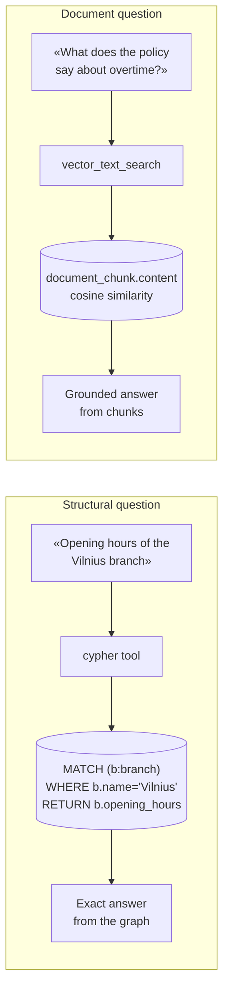

# Tools for Vedana

## Why tools exist

Vedana **doesn't let** the LLM generate answers freely from text. The assistant works through explicit tools — functions it can call to:

- inspect what's in the graph;
- retrieve data;
- assemble an answer grounded in real system data.

The LLM in Vedana is an agent. It receives a question, decides which tool is appropriate, executes it, and uses the result to form an answer. It doesn't guess — it **looks things up**.

If the first result is insufficient, the agent can keep exploring (call additional tools or refine its approach) until it has what it needs or hits the round budget (default 5, set per scenario with `max_iters` — see [Tool choice & the agent loop](../architecture/agent-loop.md)).

What the agent **cannot** do:

- invent a tool that doesn't exist;
- call a tool the active scenario doesn't allow (`tools_allowed`);
- access data outside the declared data model.

This is by design — it's what makes the system predictable, auditable, and safe to deploy in production.

## Built-in tools

Vedana ships with two core retrieval tools out of the box — `vector_text_search` and `cypher` — plus a scenario-control tool and optional extras. The tool factories live in `libs/vedana-core/src/vedana_core/tools.py` and are assembled per request by `build_tools(...)`.

| Tool                         | Registered                         | Arguments                                   | Purpose                                                                                 |
| ---------------------------- | ---------------------------------- | ------------------------------------------- | ---------------------------------------------------------------------------------------- |
| `vector_text_search`         | always                             | `label`, `property`, `text`, `rerank_top_k?` | Semantic search over pgvector.                                                          |
| `cypher`                     | always                             | `query`, `rerank_top_k?`                     | Read-only Cypher against Memgraph.                                                      |
| `select_scenario`            | always                             | `id`, `reason`                               | Switches the active playbook scenario partway through the loop. See [Agent loop](../architecture/agent-loop.md#switching-scenarios). |
| `web_search`                 | if `ENABLE_WEB_SEARCH=true`        | `query`                                      | Public web search that returns citations. See [Web search](#3-web-search).              |
| `mcp__<server>__<tool>`      | if `VEDANA_MCP_TOOL_SERVERS` is set | from the remote schema                      | Tools from remote MCP servers. See [MCP tools](../guides/mcp-tools.md).                  |

Every tool returns JSON. Retrieval tools return `{"rows": [...]}`; if a query fails, the error goes back to the agent as `{"rows": [], "error": "..."}` so it can fix the query in the next round. Every call is recorded in `rag.query_processed.technical_info.tool_calls`.

## When to use which tool



### 1. Vector Search

`vector_text_search` handles **semantic retrieval over text**. It works by embedding the user query and finding the nearest matching content stored in pgvector — document chunks, FAQ entries, or other embeddable fields.

Suited to questions where the answer lives somewhere in text and needs to be found by meaning rather than exact match. Handles natural language well, tolerates phrasing variations.

Arguments (see `VTSArgs` in code):

- `label` — anchor / link name to search;
- `property` — the specific attribute (must be `embeddable=true`);
- `text` — text to search similarity against;
- `rerank_top_k` — optional; how many of the best results to keep after [reranking](#reranking-tool-results).

Technically `label` and `property` are constrained via an `Enum` schema built from the data model's available vector indices. The LLM can't ask to search a field that doesn't exist.

How it works:

1. Embeddings are already stored in pgvector (populated by the ETL pipeline).
2. The query text is embedded by the `EMBEDDINGS_MODEL`.
3. Cosine similarity > threshold → top_n results (both from the attribute's `embed_threshold` / `embed_top_n`).
4. A list of rows with `similarity` and node/edge attributes is returned.

**Example (from a real playbook):**

```
vector_text_search(label="interest", property="interest_name", text="quokkas")
```

**Where it doesn't work.** Vector search doesn't understand structure or relationships. It can't reliably traverse the graph, count entities, apply strict filters, or follow multiple hops. For that you need Cypher.

### 2. Cypher

`cypher` handles **structured graph queries**. On call, the LLM generates a Cypher query based on the user's question and the data model description, runs it against Memgraph, and gets a structured result.

Cypher operates only on what is **explicitly modeled** — anchors, attributes, links. It does not approximate or infer. If you ask how many products are in category X, it **counts** them. If you ask which branches stock product Y, it walks the relationship and returns **all** matches.

Arguments:

- `query` — Cypher query;
- `rerank_top_k` — optional; how many of the best rows to keep after [reranking](#reranking-tool-results).

The query is executed in read-only mode (`execute_ro_cypher_query`); the result is limited to `CYPHER_ROWS_LIMIT` rows (default `1000`). The cap is kept high on purpose so the reranker has a large pool to work with.

**Example:**

```cypher
MATCH (p:Product)-[:OFFER_belongs_to_CATEGORY]->(c:Category)
WHERE c.category_name = "Embedded lighting"
RETURN p
LIMIT 30
```

**When you need it:**

- attribute filtering (`WHERE price < 500`);
- relationship traversal (`MATCH (a)-[:LINK]->(b)`);
- deterministic domain queries;
- multi-hop graph exploration.

### 3. Web search

`web_search` looks things up on the public web when the answer isn't in the knowledge base. Enable it with `ENABLE_WEB_SEARCH=true`.

Arguments:

- `query` — a full, self-contained question.

It runs one completion through LiteLLM's `web_search_options`, using `WEB_SEARCH_MODEL` (or `MODEL` if unset) and `WEB_SEARCH_CONTEXT_SIZE` (`low` / `medium` / `high`), and returns `{"text": ..., "citations": [{"url", "title"}]}`. The chosen model has to support search.

Like MCP tools, `web_search` is only available inside scenarios that list it in `tools_allowed` — add it only where reaching outside the knowledge graph is acceptable.

### Reranking tool results

If `RERANKER_BACKEND=cohere`, the rows from `vector_text_search` and `cypher` are reranked against the **user's original question** (not the tool's search text). Each row gets a `rerank_score`, and the agent can pass `rerank_top_k` to keep only the best rows. Up to `RERANKER_MAX_DOCS` rows are sent. If the reranker fails or returns nothing, the rows keep their original order and nothing is dropped.

With `RERANKER_BACKEND=disabled` (the default), `rerank_top_k` simply truncates the list.

## Tool selection

The assistant can only use the tools the active scenario allows. Every round, Vedana sends the LLM only the tools in the scenario's `tools_allowed`, and refuses any other call with "Tool X is not available in the current scenario." Before a scenario is selected, the allowed set is the defaults (`vector_text_search`, `cypher`) plus `select_scenario`. The scenario's `tool_choice` can also force (`required`) or forbid (`none`) tool calls on its first round.

Within those limits the assistant picks tools dynamically based on:

- the question type;
- the available anchor types;
- the data model structure;
- the playbook (Queries) instructions.

It can pick **vector search**, **cypher**, or **a combination of both**.

**Example 1.** "What are the opening hours of the Moscow branch?" → Cypher (structured lookup on `Branch.opening_hours`).

**Example 2.** "What does the policy say about overtime?" → vector search over document chunks.

**Hybrid scenario:**

1. Vector search finds candidate chunks of the document.
2. Cypher narrows the result through graph structure.
3. The LLM assembles the final answer.

## Extending tools

Tools are extensible. If your domain needs capabilities beyond Cypher and vector search, you can implement a custom tool:

- external API queries;
- calculations;
- ERP integrations;
- domain logic.

A custom tool must:

- have a clear input/output schema (`pydantic.BaseModel` for arguments, or a JSON Schema);
- be deterministic;
- be registered with the agent;
- be listed in `tools_allowed` of the scenarios that should use it.

See [Writing a Custom Tool](../guides/custom-tools.md). Tools that already live in another service can be connected without code through [MCP](../guides/mcp-tools.md).

## The determinism boundary

Tools are deterministic. The LLM is probabilistic.

This separation is the point: the correctness of an answer in Vedana follows from the tools — from what's actually in the graph and what the query actually returns. The LLM's job is to pick the right tool and format the result in readable language. **The LLM doesn't define what's true. The data does.**

As long as tool results are stable and the data model is well-defined, the structural correctness of answers is stable too.
