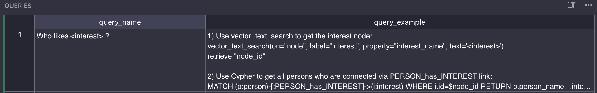
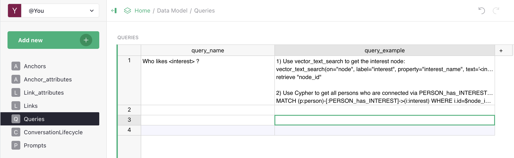

# Queries (playbook)

The **Queries** table is Vedana's playbook. It describes **exactly how** the assistant should answer typical questions: which tool it can call, which tool to call first, with what parameters, what to do with the result, which tool to call next.

If the data model describes *what exists*, then Queries describe *how to use it*.



## Fields

| Field                | Type in Grist                          | Default when blank                                   | Description                                                                                                          |
| -------------------- | -------------------------------------- | ----------------------------------------------------- | --------------------------------------------------------------------------------------------------------------------- |
| **query_name**       | Text                                   | required                                              | A short, stable scenario name or question pattern (`Who likes <interest>?`, `Give product information by SKU`). Routing, events and evals refer to scenarios by this name. |
| **query_example**    | Text                                   | —                                                     | A step-by-step instruction: what to do, in what order, with what parameters, how to handle the result.              |
| **tool_choice**      | Choice: `auto` / `required` / `none`   | `auto`                                                | How the scenario's **first** round treats tools. `required` makes the agent call a tool; `none` answers without tools and without graph context. Later rounds use `auto`. |
| **tools_allowed**    | Choice List or comma/newline text      | `vector_text_search, cypher, inspect_data_model`      | The only tools this scenario can call. Names are case-sensitive (`mcp__salary__ask`). Add `select_scenario` to let the agent switch away from this scenario. |
| **max_iters**        | Integer ≥ 1                            | `AGENT_MAX_ITERS` (5)                                 | How many tool rounds the scenario gets. Limited by `AGENT_MAX_ITERS_CEILING`.                                         |
| **routing_examples** | Choice List                            | none                                                  | Example user questions for this scenario, used by [scenario routing](./scenario-routing.md).                          |

Only `query_name` and `query_example` are required; the other columns can be added to the Grist table when you need them. If a column doesn't exist, every row gets its default.

The ETL validates these columns, and the data model load **fails** if `tool_choice` is anything other than `auto`, `required` or `none`, or if `max_iters` isn't a positive integer. The error lists the offending `query_name`s. Tool names in `tools_allowed` aren't checked at ETL time, because MCP tools are discovered when a request runs.

> **Scenario IDs are row positions.** The LLM steps and `select_scenario` refer to scenarios by a 1-based ID: the row's position in `dm_queries`. Reordering or deleting rows changes those IDs. Events and evals use `query_name`, which stays stable — compare by name.

## Why a playbook is needed

Without one, the LLM picks a tool itself. That works, but:

- it might pick a sub-optimal tool (vector search instead of Cypher);
- it can mix retrieval strategies;
- answers are "usually right" but with no guarantee and not always in the same format.

With a playbook, behaviour becomes **structured, constrained, and auditable**. The same question is always handled the same way.

## How to write a scenario

`query_example` must be **concrete and step-by-step**. Compare:

❌ Bad (generic problem statement):
```
Find the interest and return the people connected to it.
```

✅ Good (a sequence of tool calls with parameters):
```
1) Use vector_text_search to get the interest node:
   vector_text_search(label="interest", property="interest_name", text='<interest>')
   → retrieve "node_id"

2) Use Cypher to get all persons connected via PERSON_has_INTEREST:
   MATCH (p:person)-[:PERSON_has_INTEREST]->(i:interest)
   WHERE i.id=$node_id
   RETURN p.person_name, i.interest_name

3) Format the answer as: "<interest> is liked by: <name1>, <name2>, ..."
```

The LLM follows instructions literally. The more precise the steps, the more stable the behaviour.

## Structure of a good scenario

Each scenario typically contains:

1. **When to apply** — describe the use case ("document-related questions", "product compatibility checks"). Back it with `routing_examples` so routing can find the scenario.
2. **Search strategy** — vector → Cypher, Cypher → vector, or a combination.
3. **Concrete tool calls** — with parameter names and where they come from.
4. **Answer assembly** — how exactly the final text is built.
5. **Tool policy** — `tools_allowed`, `tool_choice` and `max_iters` that match the strategy: a strict lookup can use `required` with a small `max_iters`; a research-style scenario may need more rounds and `web_search`.

## How Queries reach the LLM

For each request:

1. `DataModel.get_queries()` returns the rows from `dm_queries` (cached until the data model is next reloaded).
2. [Scenario routing](./scenario-routing.md) picks at most one scenario.
3. `to_text_descr(query_names=[scenario])` renders **only that scenario's** guidance into the typical-questions section of the system prompt using `dm_query_descr_template`:

   ```
   - [{id}] {query.name}:
   {query.example}
   ```

   If no scenario was picked and filtering is off, every scenario is rendered.

4. The scenario's `tools_allowed`, `tool_choice` and `max_iters` are applied to the agent loop (see [Tool choice & the agent loop](../architecture/agent-loop.md)).
5. If the agent calls `select_scenario`, the new scenario's guidance comes back as the tool result and replaces the earlier guidance.

## How to update the playbook



1. Open **Grist > Data Model > Queries**.
2. Create a row:
   - `query_name` — the scenario name.
   - `query_example` — the step-by-step instruction.
   - optionally `tool_choice`, `tools_allowed`, `max_iters`, `routing_examples`.
3. In the backoffice → ETL run `data_model_steps` (or the "Refresh Data Model" tab). This also re-embeds `routing_examples`.
4. Verify via evaluation that existing scenarios didn't break.

The playbook applies right after refresh — no code redeploy required.

## Versioning

Because Queries live in Grist, you have built-in change history through Grist (revision log). For production scenarios we recommend:

- keeping **separate Grist documents** for dev / staging / prod (`GRIST_DATA_MODEL_DOC_ID`);
- describing every playbook change in a separate ticket / changelog;
- having an evaluation on a golden dataset that runs before and after changes.

## Examples from a real playbook

### E-commerce: "Find products of category X cheaper than Y"

`tool_choice = required`, `tools_allowed = cypher, vector_text_search, select_scenario`, `max_iters = 4`

```
1) Cypher: get the category nodes:
   MATCH (c:category) WHERE c.category_name = "<category>" RETURN c.id

2) Cypher: get linked products with the price filter:
   MATCH (p:product)-[:PRODUCT_belongs_to_CATEGORY]->(c:category)
   WHERE c.id = $cat_id AND p.price < $max_price
   RETURN p.product_name, p.price ORDER BY p.price ASC

3) Format: list "<name> — <price> EUR".
```

### Documents: "What does the policy say about returns?"

`tool_choice = auto`, `tools_allowed = vector_text_search, cypher`

```
1) Vector search over document_chunks:
   vector_text_search(label="document_chunk", property="content", text="<user question>")

2) Get the parent document:
   MATCH (d:document)-[:DOCUMENT_has_DOCUMENT_CHUNK]->(c:document_chunk)
   WHERE c.id IN $chunk_ids RETURN d.title, d.url

3) Format: answer based on the chunks + a link to the document.
```

### Smalltalk

`tool_choice = none`

```
If the question is not domain-related (greeting, thanks, farewell):
- Reply briefly in a friendly tone.
```

With `tool_choice = none` the agent can't call tools for this scenario at all, and the graph description is left out of the prompt — cheaper and more reliable than asking the LLM not to call tools. `max_iters` is `1` by the definition of "no tool calls".

## What's next

- [Scenario routing](./scenario-routing.md) — how a scenario is chosen for a question.
- [Tool choice & the agent loop](../architecture/agent-loop.md) — how the scenario's policy is applied.
- [Playbook concept](../concepts/playbook-for-vedana.md) — the theory.
- [Customizing Prompts](../guides/customizing-prompts.md) — overriding templates.
