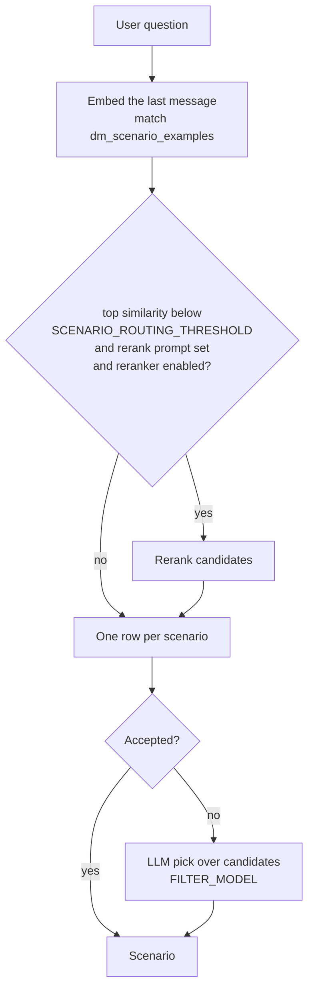

# Scenario Routing

Routing decides which [playbook](./queries.md) scenario handles a question, before the agent starts. The chosen scenario sets the agent's guidance, the tools it may call, how its first round treats tools and how many rounds it gets (see [Tool choice & the agent loop](../architecture/agent-loop.md)).

Routing runs whenever the data model has at least one query, whatever `ENABLE_DM_FILTERING` is set to. It tries the cheapest method first and only goes on to the next if that one isn't confident.



## Routing examples

Each scenario in the `Queries` table can have a `routing_examples` column (Grist Choice List) with example user questions:

| query_name                        | routing_examples                                                              |
| --------------------------------- | ------------------------------------------------------------------------------ |
| Product by category and price     | `Show pendant lamps under 200 EUR` · `Which ceiling lights cost less than 150?` |
| Who likes `<interest>`?           | `Who is into quokkas?` · `Which people like tapirs?`                             |
| Smalltalk                         | `hi` · `thanks, that helped`                                                     |

When the data model is reloaded, the ETL step `generate_scenario_example_embeddings` embeds every example with `EMBEDDINGS_MODEL` and stores it in `dm_scenario_examples(query_name, example_question, embedding)`.

Good examples:

- are phrased the way real users write, including short and informal questions;
- cover the details that separate a scenario from its neighbours (a country, a product family, "how many" vs "which");
- include common follow-up phrasings if those should land on the same scenario;
- are **not** copies of golden dataset questions — see [Evaluation](#evaluation).

## Stage 1: Embedding match

For each request, the user's last message is embedded and the `SCENARIO_ROUTING_TOP_N` closest examples (by cosine similarity) are fetched with `VectorStore.scenario_search`. If this fails (for example, the table is missing), routing continues with no matches.

## Stage 2: Rerank (optional)

The rerank step runs only when **all** of these are true:

- the best embedding similarity is **below** `SCENARIO_ROUTING_THRESHOLD` — a confident match skips the rerank call;
- the Prompts table has a `scenario_routing_rerank_query` template (formatted with `{user_query}`);
- `RERANKER_BACKEND` is not `disabled`.

Only the scenario name and the example question are sent to the reranker. Use the template to point it at what embeddings tend to blur:

```text
Which scenario handles this question: {user_query}. Pay attention to the country mentioned.
```

If the reranker fails, routing falls back to the embedding-only decision.

## Stage 3: One row per scenario

Several matched examples can belong to the same scenario. They are merged into one row that keeps the first row's position and the highest similarity and rerank score.

## Stage 4: Accept or ask the LLM

| Mode             | The top scenario is accepted when                                                                                                   |
| ---------------- | ------------------------------------------------------------------------------------------------------------------------------------ |
| No rerank        | `similarity ≥ SCENARIO_ROUTING_THRESHOLD`                                                                                             |
| Rerank applied   | `rerank_score ≥ SCENARIO_RERANK_THRESHOLD` **and** `similarity ≥ SCENARIO_RERANK_SIMILARITY_FLOOR` **and** it leads the next scenario by at least `SCENARIO_RERANK_MARGIN` |

If nothing is accepted, `RagPipeline.select_scenario` asks `FILTER_MODEL` to choose. It sees:

- the recent conversation (`PIPELINE_HISTORY_LENGTH`);
- scenario cards (`id`, `name`, `guidance`), **limited to the scenarios the embedding stage found**. If the embedding stage found none (no routing examples, or the search failed), it sees every scenario.

It returns a `ScenarioSelection` (`reasoning`, `query_id`). `query_id` can be `null`, meaning no scenario fits. An ID that doesn't exist, or a scenario outside the candidates, counts as no scenario. The prompts are `scenario_select_prompt` and `scenario_select_user_prompt` (see [Prompts](./prompts.md)).

> **Routing reads only the last message.** The embedding and rerank stages use only the user's latest message, not the conversation. Short follow-ups like "and in Germany?" usually fall through to the LLM step, which does see the conversation. Add follow-up style questions to `routing_examples` if they come up often.

## When no scenario is chosen

The agent starts without an active scenario and the allowed tools are the defaults plus `select_scenario`, so the agent can pick a scenario itself during the loop. With `ENABLE_DM_FILTERING=false` the system prompt lists **every** scenario; with filtering on, the filtered description contains no scenarios.

## The `rag.scenario_routing` event

Every routed request records one event:

```json
{
  "threshold": 0.8,
  "top_n": 10,
  "accepted": false,
  "reason": "rerank=0.412, similarity=0.733; ties with 'Tenancy law' (rerank=0.371)",
  "rerank": {
    "applied": true,
    "prompt": "scenario_routing_rerank_query",
    "query": "Which scenario handles this question: ...",
    "backend": "cohere",
    "threshold": 0.3,
    "margin": 0.1,
    "similarity_floor": 0.5
  },
  "embedding_matches": [{"query_name": "...", "example_question": "...", "similarity": 0.733}],
  "matches": [{"query_name": "...", "example_question": "...", "similarity": 0.733, "rerank_score": 0.412}]
}
```

`rag.selected_scenario` then records the final choice (`selected_scenario`, `query_id`, `reasoning`), whether it came from routing or from the LLM step.

## Tuning

| What you see                                                                  | Likely cause                                              | What to change                                                                        |
| ----------------------------------------------------------------------------- | --------------------------------------------------------- | ------------------------------------------------------------------------------------- |
| Right scenario at the top of `embedding_matches`, but `accepted: false` and similarity just under the threshold | Threshold too strict for this embedding model | Lower `SCENARIO_ROUTING_THRESHOLD` a little, or add closer `routing_examples`         |
| Wrong scenario accepted with high similarity                                   | Examples from two scenarios read almost the same          | Make the examples more distinct; add a rerank template that stresses the deciding detail |
| `reason` says `ties with …`                                                   | Reranker can't tell the top two apart                     | Improve the `scenario_routing_rerank_query` wording, or lower `SCENARIO_RERANK_MARGIN` |
| `reason` says `similarity below floor`                                         | Reranker liked a scenario the embeddings barely matched   | Usually correct to refuse; lower `SCENARIO_RERANK_SIMILARITY_FLOOR` only if evals show it helps |
| `rerank.applied: false` though a reranker is configured                        | Top similarity already met the threshold, or no rerank prompt | Expected; add a `scenario_routing_rerank_query` prompt if it's missing              |
| `matches: []`                                                                 | No routing examples, or `dm_scenario_examples` is empty    | Fill in `routing_examples` and reload the data model                                  |

Each accepted route saves one `FILTER_MODEL` call before the agent starts. Aim for a high acceptance rate on routine questions, and let unusual questions go to the LLM step.

## Evaluation

Set the `query_scenario` column in the golden dataset to the `query_name` a question should be routed to, and compare it with `rag.selected_scenario` in eval results (see [Quality Metrics & Evaluation](../product/evaluation.md#scenario-columns)).

Keep routing examples out of the test set: if a `gds_question` is also in `routing_examples`, it matches itself with similarity ≈ 1.0 and routing looks perfect in the eval. Write routing examples as paraphrases or similar questions, never copies of test questions.

## Settings

| Variable                            | Default | Meaning                                                              |
| ----------------------------------- | ------- | --------------------------------------------------------------------- |
| `SCENARIO_ROUTING_THRESHOLD`        | `0.8`   | Embedding similarity needed to accept without rerank; below it, rerank may run. |
| `SCENARIO_ROUTING_TOP_N`            | `10`    | How many example questions are fetched per request.                  |
| `SCENARIO_RERANK_THRESHOLD`         | `0.3`   | Lowest rerank score the top scenario can have.                        |
| `SCENARIO_RERANK_MARGIN`            | `0.1`   | How far the top scenario must lead the next one.                      |
| `SCENARIO_RERANK_SIMILARITY_FLOOR`  | `0.5`   | Lowest embedding similarity for a scenario picked by rerank.          |
| `RERANKER_BACKEND`                  | `disabled` | `cohere` enables reranking.                                         |
| `FILTER_MODEL`                      | `gpt-4.1-mini` | Model for the LLM fallback step.                               |
